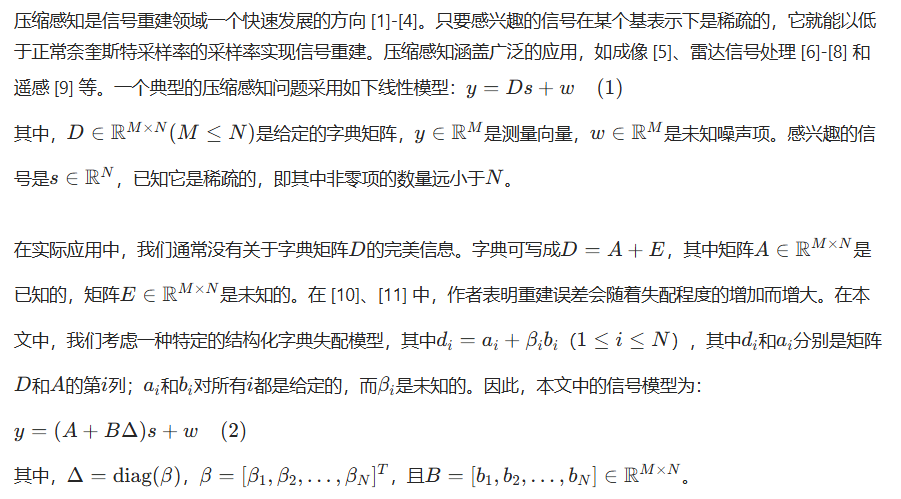
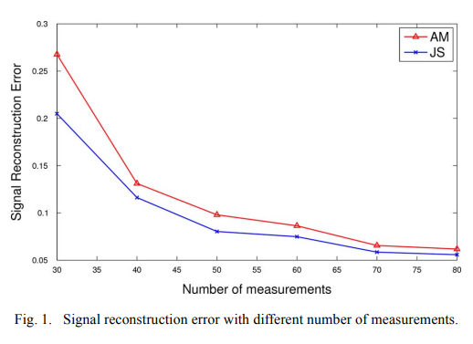
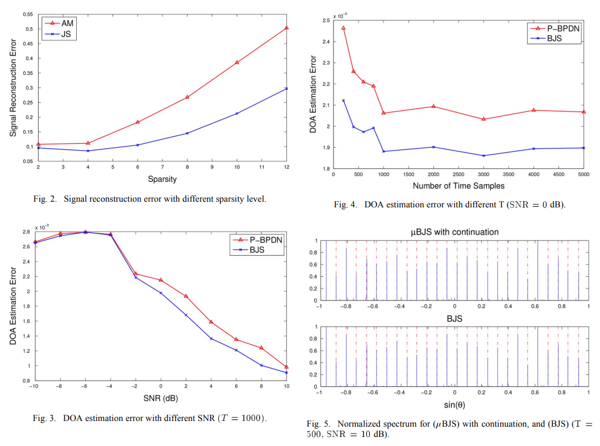
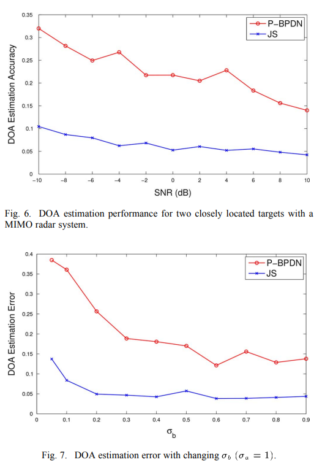

# Compressed Sensing DOA with Structured Dictionary Mismatch: A Joint Sparse Recovery Method for Compressed Sensing[With MATLAB Code]

In traditional compressed sensing theory, dictionary matrices are pre-specified. However, in practical applications, these matrices are subject to random noise and fluctuations. This paper considers a signal model where each column of the dictionary matrix is affected by structured noise. This model is common in radar systems and array processing for direction of arrival (DOA) estimation of grid-off targets. We propose using joint sparse signal recovery to address the compressed sensing problem with structural mismatches in dictionaries, and provide an analytical performance bound for this joint sparse recovery. We demonstrate that under mild conditions, the reconstruction error of the original sparse signal is determined by both the sparsity level and the noise level in the measurement model. Additionally, we implement a fast first-order algorithm to expedite the computation process. Numerical examples show that the proposed algorithm performs well, and the joint sparse recovery method yields better reconstruction results than existing methods. By implementing the joint sparse recovery method, both the accuracy and efficiency of DOA estimation are enhanced in both passive and active sensing scenarios.
This structured mismatch has been considered in [12] and [13]. Although it is a limited mismatch model, it has many applications in areas such as spectral estimation, radar signal processing, and direction of arrival (DOA) estimation. In [12] and [14], the alternating minimization method was proposed to simultaneously solve the sparse signal and mismatch β in equation (2). However, this method has slow convergence and no performance guarantees. In [15], a greedy method based on matching pursuit combined with overall least squares was proposed to handle structured mismatch in compressed sensing. The bounded mismatch parameter β in [12] and [13] is common in wave direction estimation from grid-targets. The proposed framework is based on first-order Taylor expansion and enforces the sparsity of the original signal s. They use interior-point methods [16] to solve, which require solving a linear system and can be extremely slow when the dimensionality of the problem increases. In this paper, we first propose the idea of joint sparse recovery [17] and [18] to further utilize the latent structure in compressed sensing with structured dictionary mismatch. Joint sparsity in this paper refers to the pairwise occurrence of non-zero terms in the sparse signal. When the sensor matrix A and the mismatch matrix B satisfy certain constraints, we also provide performance guarantees. For high-dimensional problems, we implement a first-order algorithmic idea called Fast Iterative Shrinkage Threshold Algorithm (FISTA) [19] to solve the joint sparse recovery problem with bounded and unbounded mismatch parameters β. FISTA is a special case of a general algorithmic framework [20] that is more efficient than interior-point methods for handling high-dimensional data. Some preliminary results of this paper are shown in [21].
We extend the theories and algorithms developed to practical applications of passive and active sensor array direction estimation. Due to the limited number of targets in the interest area, waveform direction estimation benefits from compressed sensing: both sampling energy and processing time can be significantly reduced. To achieve compressed sensing, the interest area needs to be discretized into a grid. The presence of off-grid targets significantly degrades the performance of compressed sensing. Recent studies have applied compressed sensing to active [6]-[8] and passive [22]-[23] sensor arrays. However, these works did not consider the case of off-grid targets. Based on numerical examples presented in this paper, by leveraging the first derivative of the sensor model related to off-grid targets and the joint sparsity between the original signal and mismatch parameters, the accuracy of waveform direction estimation can be improved compared to previous methods.
The organization of this paper is as follows. In Section 2, we introduce the compressed sensing model with structured dictionary mismatch and propose using joint sparsity to solve reconstruction problems. We analyze the reconstruction error performance bounds using the proposed joint sparse recovery method. In Section 3, we extend the general mismatch model to the field of waveform direction estimation with off-grid targets. In Section 4, we present the FISTA implementation of the joint sparse recovery method. In Section 5, we describe the mathematical models for passive and active sensor arrays with off-grid targets. In Section 6, we demonstrate through several numerical examples that the proposed method outperforms existing methods in compressed sensing with structured dictionary mismatch. Finally, in Section 7, we summarize this paper and point out future directions for work.
Figures are not provided in this response.
Conclusion In this paper, we propose a method to overcome the structural dictionary mismatch in compression-sensing. We utilize the joint sparse recovery model and provide the performance bounds for the joint sparse reconstruction. For grid-free compression-sensing, a bounded joint sparse recovery method is adopted. A fast algorithm based on FISTA is given to solve these joint sparse recovery models. An important application of this framework is wave direction estimation with grid-free compression-sensing. The effectiveness of the proposed algorithm is demonstrated through passive and active sensing applications. Numerical examples are used to compare the performance of the joint sparse method with other existing methods. We show that by leveraging the joint sparse properties, more satisfactory results can be obtained when there is structural dictionary mismatch. In future work, we will apply our method to other applications, analyze the relationship between the accuracy of wave direction estimation and the condition of the sensing matrix, and develop a more theoreticalized λ selection method for grid-free compression-sensing.

## Images

<!-- PAYMENT_BLOCK -->

## Get this dataset

- Payment link (Stripe): [Buy now](https://buy.stripe.com/3cs8yP7sY87d0vu9AB)
- Payment QR code: 

<!-- /PAYMENT_BLOCK -->
